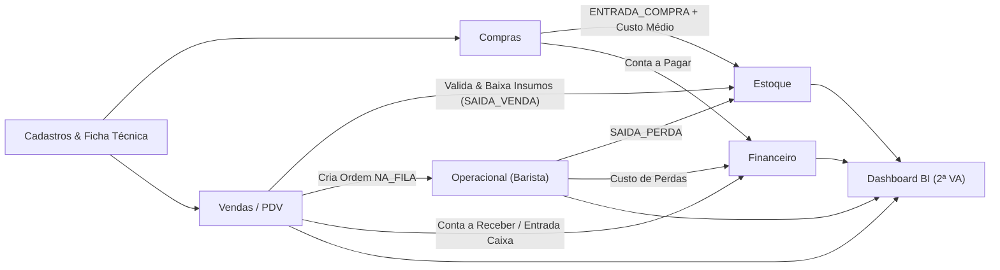

# Documentação Técnica — 1ª VA (ERP Cafeteria Grão do Agreste)

* **Disciplina:** Sistemas de Informação e Tecnologias — UFAPE (2026.2)
* **Professor:** Dr. Assuero Fonseca Ximenes
* **Sistema:** ERP Integrado para Cafeteria Artesanal (**Cafeteria Grão do Agreste**)
* **Aplicação Publicada:** [https://cafeteria-erp.streamlit.app/](https://cafeteria-erp.streamlit.app/)
* **Infraestrutura:** Python · Streamlit · PostgreSQL (Supabase) · Autenticação Google (OIDC) · GitHub · Streamlit Community Cloud

---

## 1. Descrição do Sistema

### 1.1 Contextualização do Domínio
Uma cafeteria artesanal opera sob dinâmica intensa de microtransações diárias que conectam suprimentos perecíveis (leite, itens de padaria, confeitaria), insumos nobres (grãos de café especial, chocolate belga, xaropes), preparo sob demanda (fila de baristas com tempo-alvo de atendimento) e múltiplos canais de venda (balcão, mesa, retirada e delivery).

Sem integração entre setores, cafeterias sofrem com rupturas inesperadas de insumos, desconhecimento da margem real de cada bebida (CMV impreciso), desperdícios invisíveis de perecíveis, atrasos no preparo nos horários de pico e descompasso entre o faturamento do caixa e as contas a pagar de fornecedores.

### 1.2 Objetivo do Sistema
Desenvolver um Sistema de Gestão Integrado (ERP simplificado) que represente fielmente os processos centrais de uma cafeteria, garantindo:
* Entrada estruturada e validada de dados operacionais;
* Integração transacional real (ACID) entre Cadastros, Compras, Estoque, Vendas/PDV, Operacional (Barista/Perdas) e Financeiro;
* Controle de acesso autenticado via conta Google com rastreabilidade por usuário;
* Preservação integral do histórico transacional com carimbos temporais (`TIMESTAMPTZ`), constituindo a base consistente e auditável que alimenta o Dashboard BI da 2ª VA.

### 1.3 Escopo Implementado
* Autenticação Google OAuth 2.0 / OIDC + Controle de Acesso Baseado em Perfis (RBAC) + Trilha de Auditoria (`audit_logs`);
* CRUD completo com exclusão lógica de Categorias, Fornecedores, Clientes, Insumos, Produtos do Cardápio e **Ficha Técnica (Receitas)**;
* Gestão de Compras com conversão de unidades (`kg/L → g/ml`), entrada automática em estoque, recálculo de custo médio ponderado e geração de Contas a Pagar;
* Controle de Estoque em tempo real, alertas de estoque mínimo, inventário auditado e razão imutável de movimentações;
* Frente de Caixa (PDV) com validação prévia de saldo de ficha técnica, baixa atômica de insumos, apuração de CMV histórico, emissão/download de comprovante e cancelamento/estorno consistente;
* Painel Operacional (Fila Kanban do Barista com medição de SLA) e Registro de Perdas/Descartes;
* Módulo Financeiro completo (Contas a Pagar/Receber, despesas operacionais manuais, liquidações no caixa, extrato de fluxo de caixa e DRE mensal).

---

## 2. Descrição dos Módulos do Sistema

| Módulo | Arquivo UI / Serviço | Papel no Sistema | Integrações Principais |
| :--- | :--- | :--- | :--- |
| **Autenticação & RBAC** | `src/auth/google_auth.py`<br>`src/auth/permissions.py` | Identifica o usuário via Google OIDC, sincroniza o perfil na tabela `usuarios` e restringe módulos/ações por perfil (`ADMIN`, `GERENTE`, `CAIXA`, `BARISTA`, `ESTOQUISTA`). | Presente em todos os módulos (injeta `usuario_id` em cada operação e em `audit_logs`). |
| **Visão Geral** | `src/ui/pages/01_visao_geral.py` | Painel inicial com faturamento do dia, pedidos em aberto no barista, insumos críticos, contas atrasadas/vencendo e administração de perfis/auditoria (`ADMIN`). | Consome Vendas, Estoque, Operacional, Financeiro e Auditoria. |
| **Cadastros & Ficha Técnica** | `src/ui/pages/02_cadastros.py`<br>`src/services/cadastros_service.py` | Mantém todas as entidades mestras e vincula cada produto do cardápio aos insumos consumidos (receita), além de registrar histórico de reajustes de preço. | Base estrutural consumida por Compras, Estoque, Vendas, Operacional, Financeiro e BI. |
| **Compras** | `src/ui/pages/03_compras.py`<br>`src/services/compras_service.py` | Controla pedidos de compra junto aos fornecedores, lotes, validades e recebimentos. | Ao receber: alimenta **Estoque** (entrada + custo médio ponderado) e cria **Conta a Pagar** no **Financeiro**. |
| **Estoque & Inventário** | `src/ui/pages/04_estoque.py`<br>`src/services/estoque_service.py` | Acompanha posição atual, localização física, itens abaixo do mínimo, ajustes de inventário e razão imutável de movimentações. | Recebe entradas de **Compras** e saídas/estornos de **Vendas** e **Operacional**. |
| **Vendas / PDV** | `src/ui/pages/05_vendas_pdv.py`<br>`src/services/vendas_service.py` | Registra vendas comerciais, emite comprovante, controla histórico e gerencia cancelamentos/estornos. | Consome **Cadastros/Ficha Técnica**, baixa **Estoque**, abre ordem no **Operacional** e lança receita/caixa no **Financeiro**. |
| **Operacional (Barista)** | `src/ui/pages/06_operacional.py`<br>`src/services/operacional_service.py` | Executa o preparo dos pedidos (`NA_FILA → EM_PREPARO → PRONTO → ENTREGUE`), mede tempos reais de espera/preparo (SLA) e registra perdas de insumos. | Recebe ordens de **Vendas**, baixa perdas no **Estoque** e compõe custos de perdas na DRE/**BI**. |
| **Financeiro** | `src/ui/pages/07_financeiro.py`<br>`src/services/financeiro_service.py` | Consolida títulos a pagar/receber, despesas fixas/operacionais, liquidações no caixa, extrato de fluxo de caixa e DRE mensal. | Recebe títulos automáticos de **Vendas** e **Compras** e alimenta os indicadores financeiros do **BI**. |

---

## 3. Arquitetura do Sistema e Justificativa Técnica

O sistema adota **Arquitetura em Camadas (Layered Architecture)** sobre Python + Streamlit + PostgreSQL (Supabase), garantindo separação nítida entre apresentação, regras de negócio e persistência:

```text
[ Interface Streamlit (src/ui/pages & components) ]
                      │  (nunca executa SQL diretamente)
                      ▼
[ Autenticação & RBAC (src/auth) ] ──▶ [ Serviços & Regras de Negócio (src/services) ]
                                                         │  (transações ACID)
                                                         ▼
                                    [ Acesso a Dados (src/db) — SQLAlchemy + psycopg ]
                                                         │
                                                         ▼
                                    [ PostgreSQL 15+ no Supabase (sql/001..003) ]
```

### Decisões Arquiteturais Principais
1. **Desacoplamento da Regra de Negócio (`src/services`):** toda lógica transacional reside em funções Python puras que não importam widgets do Streamlit. Isso permite reutilizar os mesmos serviços na interface web, no script de carga inicial (`scripts/seed_db.py`) e na suíte automatizada de testes (`pytest`).
2. **Engine Singleton compatível com Supabase Pooler (`src/db/connection.py`):** usa `@st.cache_resource` no Streamlit, `NullPool` com `prepare_threshold=None` para o Transaction Pooler IPv4 do Supabase (`porta 6543`) e `pool_pre_ping=True` para reconexão transparente.
3. **Autenticação OIDC Nativa (`st.login("google")`):** elimina bibliotecas externas frágeis a cookies/iframes, funciona nativamente no Streamlit Community Cloud e sincroniza automaticamente o perfil no PostgreSQL (`usuarios`), garantindo acesso administrativo imediato ao avaliador (`assuero.ximenes@ufape.edu.br`).
4. **SQL Versionado e Transparente (`sql/`):** DDL, índices e views analíticas ficam versionados em SQL explícito, facilitando auditoria acadêmica e execução direta via `scripts/init_db.py` ou Supabase SQL Editor.

---

## 4. Modelo de Dados e Garantia de Histórico

O modelo relacional completo conta com **19 tabelas** e **6 views analíticas**, documentadas em detalhe em [`docs/MER.md`](./MER.md).

### Estratégia de Temporalidade e Histórico Imutável
Para atender integralmente a seção 9.3 do `especificacao.md` (base consistente para a 2ª VA):
* **Carimbos temporais (`TIMESTAMPTZ`):** todas as tabelas possuem `criado_em` (e `atualizado_em`, `data_venda`, `data_pedido`, `data_recebimento`, `iniciado_em`, `finalizado_em`, `entregue_em`, `data_movimentacao`), permitindo análises por data, dia da semana e hora em `America/Sao_Paulo`.
* **Exclusão lógica em cadastros:** nenhum cadastro (`produtos`, `insumos`, `clientes`, `fornecedores`, `categorias`, `ficha_tecnica_itens`) sofre `DELETE`; a inativação usa `ativo = FALSE`, preservando integridade referencial de transações antigas.
* **Tabelas *Append-Only*:** `movimentacoes_estoque`, `movimentacoes_financeiras`, `ordem_preparo_historico`, `historico_precos_produtos`, `registros_perdas` e `audit_logs` nunca sofrem sobrescrita.
* **Snapshots de Preço e CMV:** `venda_itens` grava `preco_unitario_snapshot` e `custo_unitario_cmv_snapshot` no momento exato da venda. Assim, reajustes futuros de preço de venda ou de custo de compra não distorcem retroativamente o lucro histórico.

---

## 5. Integração entre Módulos (Fluxo de Dados)



### Principais Operações Integradas (Executadas em Transação ACID Única)

1. **Recebimento de Compra (`compras_service.receber_compra`):**
   * Bloqueia o pedido e os insumos (`SELECT ... FOR UPDATE` ordenados por `insumo_id`);
   * Recalcula o **Custo Médio Ponderado** de cada insumo;
   * Soma `estoque_atual` e registra `ENTRADA_COMPRA` em `movimentacoes_estoque`;
   * Gera automaticamente título `PAGAR` em `titulos_financeiros` com vencimento calculado pelo prazo do fornecedor (e baixa no caixa se configurado pagamento à vista).
2. **Finalização de Venda no PDV (`vendas_service.registrar_venda`):**
   * Valida existência de Ficha Técnica ativa para cada produto;
   * Agrega o consumo total de insumos de todo o carrinho e trava os registros de `insumos` com `FOR UPDATE`;
   * Bloqueia a venda (`InsufficientStockError`) se qualquer insumo ficar abaixo do necessário;
   * Grava `vendas` e `venda_itens` com snapshots de preço e CMV;
   * Baixa os insumos em `movimentacoes_estoque` (`SAIDA_VENDA`);
   * Abre `ordens_preparo` (`NA_FILA`) + histórico inicial;
   * Cria título `RECEBER` em `titulos_financeiros`: para `PIX`, `DEBITO` e `DINHEIRO`, liquida imediatamente lançando `ENTRADA` em `movimentacoes_financeiras`; para `CREDITO` (D+30) e `FATURADO` (D+15), mantém em aberto para liquidação futura.
3. **Cancelamento de Venda (`vendas_service.cancelar_venda`):**
   * Marca a venda como `CANCELADA` com motivo, usuário e timestamp (sem apagar registro);
   * Se a ordem ainda estava `NA_FILA`, devolve os insumos ao estoque via `ESTORNO_VENDA`; se já havia entrado em preparo (`EM_PREPARO`/`PRONTO`/`ENTREGUE`), não retorna insumo já preparado e contabiliza o consumo em `registros_perdas`;
   * Cancela o título financeiro e, se o dinheiro já havia entrado no caixa, registra uma `SAIDA` compensatória em `movimentacoes_financeiras`.
4. **Registro de Perda Operacional (`operacional_service.registrar_perda`):**
   * Baixa o saldo em `insumos`, grava `SAIDA_PERDA` em `movimentacoes_estoque` e registra o custo apurado (`quantidade × custo_medio_atual`) em `registros_perdas`.

---

## 6. Regras de Negócio Implementadas

| Código | Regra de Negócio | Onde é Garantida | Justificativa no Contexto da Cafeteria |
| :--- | :--- | :--- | :--- |
| **RN-01** | Produto só pode ser vendido se possuir Ficha Técnica ativa. | `vendas_service.py` | Impede vendas "cegas" sem baixa de estoque nem cálculo de CMV. |
| **RN-02** | Proibição absoluta de estoque negativo. | `vendas_service.py`, `operacional_service.py`, `estoque_service.py` e `CHECK (estoque_atual >= 0)` no PostgreSQL | Garante coerência física do estoque e evita vendas sem insumos disponíveis. |
| **RN-03** | Padronização de insumos em unidade base única (`g`, `ml`, `un`). | `001_schema.sql` e conversão assistida na UI de Compras | Elimina erros de fator 1000× entre compras em kg/L e receitas em g/ml. |
| **RN-04** | Custo Médio Ponderado atualizado a cada recebimento de compra. | `compras_service.py` | Reflete a variação real de preços de café e leite no CMV de forma contábil. |
| **RN-05** | Snapshots imutáveis de preço e CMV em `venda_itens`. | `vendas_service.py` | Protege a fidelidade histórica das análises de rentabilidade da 2ª VA. |
| **RN-06** | Transições válidas da fila do barista (`NA_FILA → EM_PREPARO → PRONTO → ENTREGUE`). | `operacional_service.py` | Impede pulos de etapa e assegura medição fidedigna de tempo de fila e preparo. |
| **RN-07** | Estorno condicional de estoque conforme estágio de preparo no cancelamento. | `vendas_service.py` | Se o café já foi preparado, o insumo foi consumido (perda) e não pode voltar à prateleira. |
| **RN-08** | Títulos originados de Vendas/Compras não podem ser cancelados manualmente no Financeiro. | `financeiro_service.py` | Mantém sincronismo estrito entre Financeiro e o módulo operacional de origem. |
| **RN-09** | Cálculo dinâmico de títulos atrasados (`status = 'ABERTO' AND data_vencimento < CURRENT_DATE`). | `financeiro_service.py` e `bi_service.py` | Evita dependência de rotinas agendadas e mantém inadimplência sempre atualizada. |
| **RN-10** | Controle de acesso RBAC e trilha de auditoria para toda operação de escrita. | `permissions.py` e `audit_service.py` | Garante governança, segurança da informação e responsabilização por ação. |

---

## 7. Massa de Dados Inicial (*Seed*) e Validação Automatizada

* **Seed Realista (`scripts/seed_db.py`):** gera 90 dias corridos de operações completas passando pelos próprios serviços do ERP (~1.000 vendas com sazonalidade semanal e horária, compras com evolução realista de preços, preparo com SLA, perdas em perecíveis, despesas fixas mensais e liquidações financeiras), assegurando base consistente tanto para demonstração na 1ª VA quanto para análises temporais da 2ª VA.
* **Testes Automatizados (`tests/`):** validam RBAC, formatação/comprovante, atomicidade em estoque insuficiente, custo médio ponderado, baixa de ficha técnica, cancelamento pré/pós-preparo, SLA do barista, registro de perdas e coerência matemática dos KPIs de BI.
