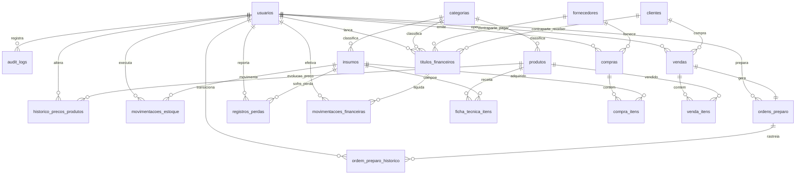

# Modelo Entidade-Relacionamento (MER) e Dicionário de Dados

**Sistema:** ERP + Dashboard BI — Cafeteria Grão do Agreste  
**SGBD:** PostgreSQL 15+ (Supabase)  
**Scripts SQL:** [`sql/001_schema.sql`](../sql/001_schema.sql), [`sql/003_indexes_and_constraints.sql`](../sql/003_indexes_and_constraints.sql) e [`sql/002_views_bi.sql`](../sql/002_views_bi.sql)

---

## 1. Diagrama Entidade-Relacionamento (MER)

---

## 2. Dicionário das 19 Tabelas Transacionais e Cadastrais

Todas as tabelas utilizam chave primária substituta `BIGSERIAL` e colunas `TIMESTAMPTZ` (com fuso horário) para garantir temporalidade exata nas análises da 2ª VA.

| # | Tabela | Domínio | Natureza | Principais Colunas, FKs e Restrições |
| :-: | :--- | :--- | :--- | :--- |
| 1 | `usuarios` | Auth / RBAC | Cadastral (exclusão lógica) | `google_sub` (UNIQUE), `email` (UNIQUE), `perfil` (`ADMIN`, `GERENTE`, `CAIXA`, `BARISTA`, `ESTOQUISTA`), `ativo`, `ultimo_login_em`. |
| 2 | `audit_logs` | Auditoria | **Append-only** | `usuario_id` (FK), `modulo`, `entidade`, `entidade_id`, `acao`, `detalhes_json` (`JSONB`), `criado_em`. |
| 3 | `categorias` | Cadastros | Cadastral (exclusão lógica) | `nome`, `tipo` (`PRODUTO`, `INSUMO`, `DESPESA`, `RECEITA`), `UNIQUE(nome, tipo)`, `ativo`. |
| 4 | `fornecedores` | Cadastros | Cadastral (exclusão lógica) | `razao_social`, `nome_fantasia`, `cnpj` (UNIQUE), `prazo_pagamento_dias >= 0`, `ativo`. |
| 5 | `clientes` | Cadastros | Cadastral (exclusão lógica) | `nome`, `cpf_cnpj` (UNIQUE), `tipo_cliente` (`BALCAO`, `FIDELIDADE`, `CORPORATIVO`), `ativo`. |
| 6 | `insumos` | Cadastros / Estoque | Cadastral + Saldo Atual | `sku` (UNIQUE), `categoria_id` (FK), `unidade_medida` (`g`, `ml`, `un`), `estoque_atual >= 0`, `estoque_minimo >= 0`, `custo_medio_atual >= 0`, `localizacao`, `perecivel`. |
| 7 | `produtos` | Cadastros | Cadastral (exclusão lógica) | `sku` (UNIQUE), `categoria_id` (FK), `tipo_produto` (`PREPARADO`, `REVENDA`), `preco_venda > 0`, `tempo_preparo_estimado_seg >= 0`. |
| 8 | `ficha_tecnica_itens` | Cadastros / Produção | Relacional N:N | `produto_id` (FK), `insumo_id` (FK), `quantidade > 0`, `UNIQUE(produto_id, insumo_id)`, `ativo`. |
| 9 | `historico_precos_produtos` | Cadastros | **Append-only** | `produto_id` (FK), `preco_anterior`, `preco_novo > 0`, `alterado_por` (FK `usuarios`), `criado_em`. |
| 10 | `compras` | Compras | Transacional | `numero_pedido` (UNIQUE), `fornecedor_id` (FK), `usuario_id` (FK), `status` (`RASCUNHO`, `CONFIRMADA`, `RECEBIDA`, `CANCELADA`), `data_pedido`, `data_recebimento`, `valor_total >= 0`. |
| 11 | `compra_itens` | Compras | Transacional | `compra_id` (FK), `insumo_id` (FK), `quantidade > 0`, `custo_unitario >= 0`, `subtotal >= 0`, `lote`, `data_validade`. |
| 12 | `movimentacoes_estoque` | Estoque | **Append-only** | `insumo_id` (FK), `tipo_movimentacao` (`ENTRADA_COMPRA`, `SAIDA_VENDA`, `SAIDA_PERDA`, `AJUSTE_ENTRADA`, `AJUSTE_SAIDA`, `ESTORNO_VENDA`), `quantidade > 0`, `saldo_anterior`, `saldo_posterior`, `custo_unitario_snapshot`, `origem_modulo`, `origem_id`, `usuario_id` (FK). |
| 13 | `vendas` | Vendas / PDV | Transacional (sem DELETE) | `numero_venda` (UNIQUE), `cliente_id` (FK), `usuario_id` (FK), `canal_venda`, `forma_pagamento`, `status` (`CONCLUIDA`, `CANCELADA`), `subtotal`, `desconto <= subtotal`, `valor_total`, `custo_total_cmv`, `data_venda`, `cancelada_em`, `cancelada_por`. |
| 14 | `venda_itens` | Vendas / PDV | Transacional (snapshots) | `venda_id` (FK), `produto_id` (FK), `quantidade > 0`, `preco_unitario_snapshot > 0`, `custo_unitario_cmv_snapshot >= 0`, `subtotal`. |
| 15 | `ordens_preparo` | Operacional | Transacional | `venda_id` (FK UNIQUE), `status` (`NA_FILA`, `EM_PREPARO`, `PRONTO`, `ENTREGUE`, `CANCELADO`), `barista_id` (FK), `prioridade`, `criado_em`, `iniciado_em`, `finalizado_em`, `entregue_em`, `tempo_espera_fila_seg`, `tempo_preparo_real_seg`. |
| 16 | `ordem_preparo_historico` | Operacional | **Append-only** | `ordem_preparo_id` (FK), `status_anterior`, `status_novo`, `usuario_id` (FK), `criado_em`. |
| 17 | `registros_perdas` | Operacional | **Append-only** | `insumo_id` (FK), `quantidade > 0`, `motivo` (`VENCIMENTO`, `QUEBRA_PREPARO`, `DESPERDICIO_BARISTA`, `CONTAMINACAO`, `OUTRO`), `custo_estimado >= 0`, `usuario_id` (FK), `criado_em`. |
| 18 | `titulos_financeiros` | Financeiro | Transacional | `tipo` (`RECEBER`, `PAGAR`), `categoria_id` (FK), `origem_modulo` (`VENDAS`, `COMPRAS`, `OPERACIONAL`, `MANUAL`), `origem_id`, `cliente_id` (FK), `fornecedor_id` (FK), `valor_original > 0`, `valor_pago >= 0`, `data_competencia`, `data_vencimento`, `data_liquidacao`, `status` (`ABERTO`, `PAGO`, `CANCELADO`). |
| 19 | `movimentacoes_financeiras` | Financeiro | **Append-only** | `titulo_id` (FK), `tipo_fluxo` (`ENTRADA`, `SAIDA`), `valor > 0`, `forma_pagamento`, `data_movimentacao`, `descricao`, `usuario_id` (FK). |

---

## 3. Views Analíticas (Camada BI — 2ª VA)

Definidas em [`sql/002_views_bi.sql`](../sql/002_views_bi.sql), todas consultam exclusivamente as tabelas operacionais acima:

1. **`vw_bi_vendas_diarias`**: consolidação diária por canal e forma de pagamento (receita bruta/líquida, descontos, CMV, margem bruta e ticket médio).
2. **`vw_bi_produtos_desempenho`**: desempenho diário por produto, categoria e canal (volume, receita, CMV e margem de contribuição) para ranking e Curva ABC.
3. **`vw_bi_horarios_pico`**: agregação por dia da semana e hora (`America/Sao_Paulo`) para mapa de calor de demanda.
4. **`vw_bi_estoque_saude`**: posição atual por insumo, valor imobilizado, criticidade (`CRITICO`, `ATENCAO`, `SAUDAVEL`), consumo/perdas dos últimos 30 dias e cobertura estimada em dias.
5. **`vw_bi_operacional_sla`**: métricas de fila, tempo real de preparo vs. meta estimada por venda e indicador booleano `dentro_sla` por hora e barista.
6. **`vw_bi_financeiro_dre_fluxo`**: consolidação mensal de receitas, CMV, perdas, despesas operacionais, lucro bruto, resultado líquido e fluxo de caixa (entradas × saídas).
